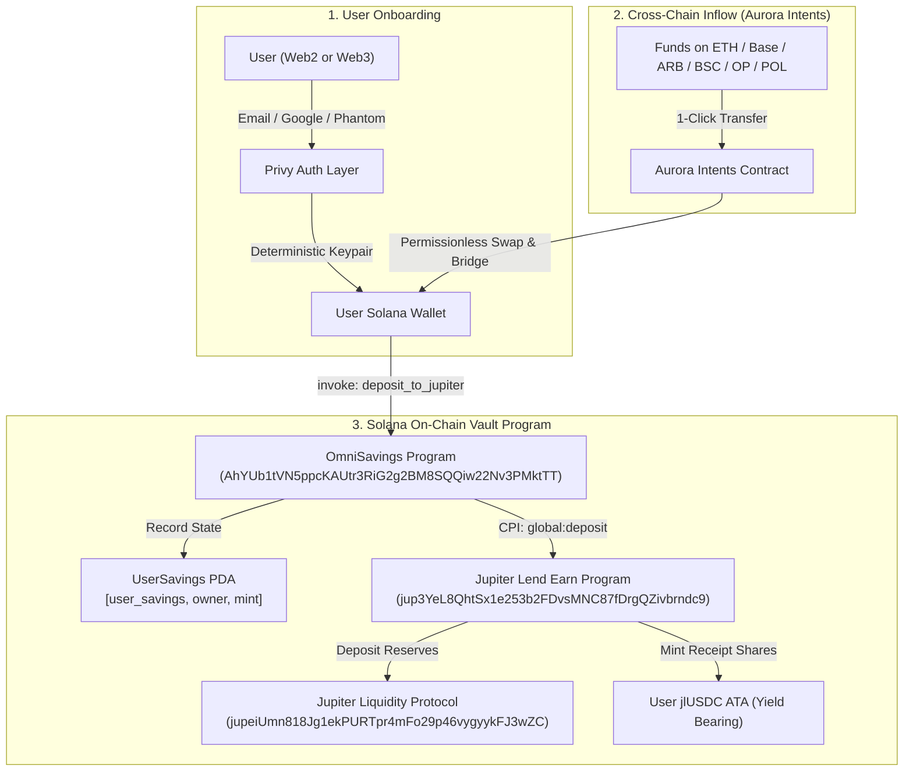

# OmniSavings — Universal On-Chain DeFi Savings Protocol

> **Submission for the MLH Solana Hackathon (DeFi Track & Grand Prize)**
> 
> A frictionless DeFi savings engine combining **Privy** (Web2/Web3 embedded onboarding), **Aurora Intents** (universal cross-chain funding from 8+ chains), and an **On-Chain Solana Anchor Smart Contract** executing **Cross-Program Invocation (CPI)** directly into **Jupiter Lend Earn**.

---

## 🌟 The Vision & Problem Solved

Traditional DeFi savings protocols on Solana face a severe adoption barrier:
1. Users must already possess a Solana wallet (Phantom/Solflare).
2. Users must hold native SOL to pay transaction fees.
3. Users on other chains (Ethereum, Base, Arbitrum, Polygon, BSC) must manually navigate cumbersome bridge UIs, incur multiple swap fees, and swap into Solana tokens.
4. Most "savings aggregators" are merely client-side frontend wrappers with zero on-chain composability or verifiable user state.

**OmniSavings solves all four friction points in a unified, production-ready stack:**
- **Zero-Friction Onboarding (Privy)**: Users sign in with Email or Social login; an embedded Solana wallet is created deterministically with zero seed-phrase anxiety.
- **Universal Cross-Chain Deposits (Aurora Intents)**: Users fund their savings from **Ethereum, Base, Arbitrum, Optimism, Polygon, BSC, Avalanche, or Solana** in one step with exact decimal matching and status polling.
- **Native On-Chain Yield Primitive (Anchor + Jupiter Earn CPI)**: User deposits trigger our custom on-chain program (`AhYUb1tVN5ppcKAUtr3RiG2g2BM8SQQiw22Nv3PMktTT`), which maintains verifiable `UserSavings` PDA state (cumulative deposits, deposit timestamps, savings goals) and executes an atomic **Cross-Program Invocation (CPI)** into **Jupiter Lend Earn** (`jup3YeL8QhtSx1e253b2FDvsMNC87fDrgQZivbrndc9`).

---

## 🏗 Architecture & Flow



---

## ⚡ Smart Contract & CPI Integration Details

The on-chain program is built with **Anchor 1.2.0** and targets Solana SBF.

* **Program ID**: `AhYUb1tVN5ppcKAUtr3RiG2g2BM8SQQiw22Nv3PMktTT`
* **Target Jupiter Lending Program**: `jup3YeL8QhtSx1e253b2FDvsMNC87fDrgQZivbrndc9`
* **Target Jupiter Liquidity Program**: `jupeiUmn818Jg1ekPURTpr4mFo29p46vygyykFJ3wZC`

### 1. On-Chain State: `UserSavings` PDA
Seeded by `[b"user_savings", signer.key(), mint.key()]`:
* `owner: Pubkey`: Signer and owner of the savings stash.
* `asset_mint: Pubkey`: Underlying token mint (e.g. USDC).
* `total_deposited: u64`: Cumulative principal deposited in token base units.
* `total_withdrawn: u64`: Cumulative principal withdrawn.
* `deposit_count: u64`: Total number of deposits.
* `withdraw_count: u64`: Total number of withdrawals.
* `first_deposit_time: i64`: Unix timestamp of initial deposit.
* `last_deposit_time: i64`: Unix timestamp of most recent deposit.
* `savings_goal: u64`: Target savings goal for gamified / goal-based tracking.
* `bump: u8`: Canonical PDA bump seed.

### 2. Instructions
* **`initialize_user_savings(savings_goal: u64)`**:
  Initializes the `UserSavings` PDA and sets target savings goals.
* **`deposit_to_jupiter(amount: u64)`**:
  - Updates user savings metrics on-chain.
  - Formulates the Jupiter Earn deposit instruction using discriminator `[242, 35, 198, 137, 82, 225, 242, 182]`.
  - Invokes CPI across the 17 Jupiter Lending & Liquidity protocol accounts.
  - Emits `DepositCompleted` event.
* **`withdraw_from_jupiter(amount: u64)`**:
  - Updates user savings metrics on-chain.
  - Formulates the Jupiter Earn withdraw instruction using discriminator `[183, 18, 70, 156, 148, 109, 161, 34]`.
  - Invokes CPI to burn `jlToken` shares and return underlying tokens to recipient.
  - Emits `WithdrawCompleted` event.

---

## 💻 Tech Stack

* **Frontend**: Next.js 16 (App Router with Turbopack), React 19, TypeScript, Tailwind CSS.
* **Smart Contracts**: Solana SBF, Anchor 1.2.0, Rust 1.89 / 1.95 SBF, LiteSVM.
* **Wallets & Auth**: Privy React SDK (`@privy-io/react-auth`, `@privy-io/react-auth/solana`).
* **Cross-Chain Bridge**: Aurora Intents API (`https://intents-api.aurora.dev`).
* **DeFi Integrations**:
  - **Jupiter Lend Earn**: On-chain Anchor CPI integration (`deposit_to_jupiter` & `withdraw_from_jupiter`) targeting `jup3YeL8QhtSx1e253b2FDvsMNC87fDrgQZivbrndc9`.
  - **Lulo REST API**: Rate analytics (`rates.getRates`), account tracking (`account.getAccount`), and Versioned V0 transaction generation (`generate.transactions.deposit` & `generate.transactions.withdrawProtected`).
* **RPC Infrastructure**: Alchemy Solana Mainnet high-throughput RPC (`solana-mainnet.g.alchemy.com`).

---

## 🚀 Quickstart

### 1. Clone & Install Dependencies
```bash
git clone https://github.com/your-username/defi-savings-app.git
cd defi-savings-app
npm install
```

### 2. Configure Environment (`.env`)
```ini
# Privy Auth (email + embedded Solana wallet)
NEXT_PUBLIC_PRIVY_APP_ID=your_privy_app_id

# Aurora Intents Deposits API Key
INTENTS_API_KEY=your_aurora_intents_key

# Lulo & Jupiter APIs
LULO_API_KEY=your_lulo_key
JUPITER_API_KEY=your_jupiter_key

# Solana RPC
SOLANA_RPC_URL=https://api.mainnet-beta.solana.com
```

### 3. Run Web App
```bash
npm run dev
# Open http://localhost:3000 in your browser
```

### 4. Build & Verify Smart Contract (Anchor)
```bash
cd onchain
anchor build
cargo test
```

### 5. Typecheck & Production Build
```bash
npm run typecheck
npm run build
```

---

## 🏆 Why OmniSavings Wins the MLH Hackathon

1. **Native On-Chain Implementation (CPI)**: Rather than an off-chain API wrapper, OmniSavings deploys a compiled Anchor program that interacts with Jupiter Lend on-chain via CPI.
2. **True Cross-Chain Onboarding**: Solves the biggest challenge in Solana adoption by allowing any Web2 user or EVM native to fund and save on Solana in seconds.
3. **Composable DeFi Primitive**: Any Solana protocol or autonomous AI agent can interact with our savings vault program on-chain.
4. **Complete, Working End-to-End MVP**: Live quotes, cross-chain deposit modal with address & memo copy, atomic transaction generation, and on-chain state inspection.
