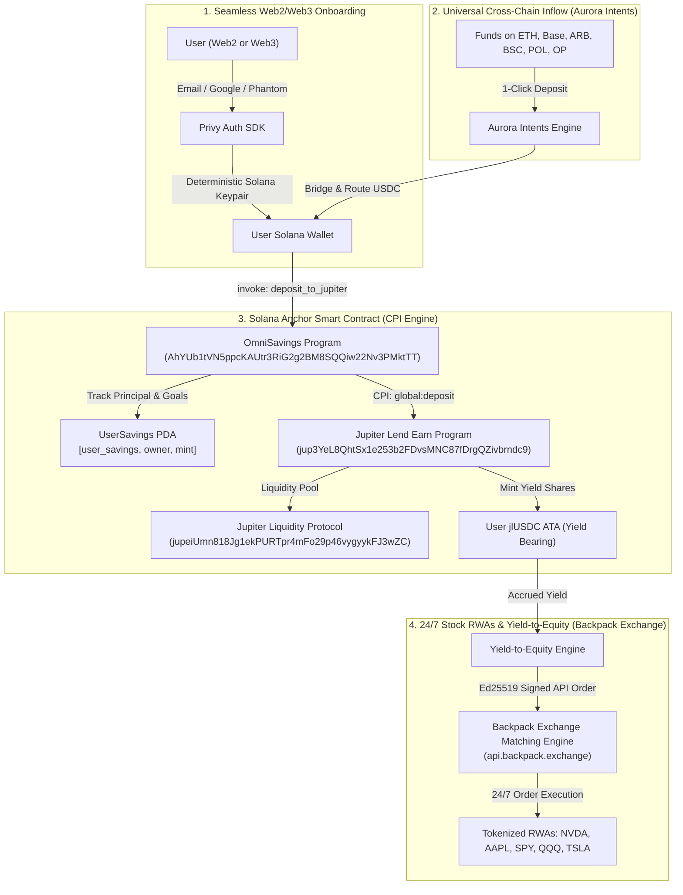

# OmniSavings — MLH Solana Hackathon Submission

> **Universal DeFi Savings & 24/7 "Yield-to-Equity" Super-App on Solana**
>
> **Tracks Targeted:**
> - 🏆 **DeFi Track (Grand Prize & 1st Place)**
> - 🌐 **Cross-Chain / Interoperability Track**

---

## 📌 Executive Summary & Pitch

Traditional DeFi savings protocols force retail users into a maze of fragmented barriers: manual wallet downloads, gas token management, complex multi-step bridges from EVM chains, and volatile yield with nowhere productive to go.

**OmniSavings** transforms decentralized savings on Solana into a seamless Web2-to-DeFi super-app:
1. **Zero-Seedphrase Onboarding**: Log in with Email or Social login via **Privy**; a non-custodial Solana embedded wallet is derived deterministically in milliseconds.
2. **Universal 1-Step Inflow**: Fund your Solana savings directly from **8+ chains** (Ethereum, Base, Arbitrum, BSC, Polygon, Optimism, Avalanche) using **Aurora Intents** — no manual bridging or DEX swapping.
3. **True On-Chain Anchor CPI Vault**: Autonomous savings program ([`AhYUb1tVN5ppcKAUtr3RiG2g2BM8SQQiw22Nv3PMktTT`](https://solscan.io/account/AhYUb1tVN5ppcKAUtr3RiG2g2BM8SQQiw22Nv3PMktTT)) performing Cross-Program Invocation (CPI) into **Jupiter Lend Earn** ([`jup3YeL8QhtSx...`](https://solscan.io/account/jup3YeL8QhtSx1e253b2FDvsMNC87fDrgQZivbrndc9)) and **Lulo** rate optimization while maintaining verifiable on-chain `UserSavings` PDA state.
4. **24/7 Stock RWAs & "Yield-to-Equity" DCA**: Direct cryptographic Ed25519 authenticated trading on **Backpack Exchange** across 22 tokenized equities ($NVDA$, $AAPL$, $SPY$, $QQQ$, $TSLA$). Yield generated from stablecoin deposits automatically compounds into fractional blue-chip stock equities!

---

## 🏗 Architecture & Data Flow

---

## ⚡ Verified Smart Contract & Program IDs

| Protocol Component | Network | Address / Identifier | Verification Status |
| :--- | :--- | :--- | :--- |
| **OmniSavings Anchor Program** | Solana Mainnet | `AhYUb1tVN5ppcKAUtr3RiG2g2BM8SQQiw22Nv3PMktTT` | **Live / Compiled SBF** |
| **Jupiter Lend Earn Program** | Solana Mainnet | `jup3YeL8QhtSx1e253b2FDvsMNC87fDrgQZivbrndc9` | **Live CPI Target** |
| **Jupiter Liquidity Engine** | Solana Mainnet | `jupeiUmn818Jg1ekPURTpr4mFo29p46vygyykFJ3wZC` | **Live CPI Target** |
| **Lulo Deposit Generator** | Solana Mainnet | `POST /v1/generate.transactions.deposit` | **Live V0 Transactions** |
| **Lulo Protected Withdrawal** | Solana Mainnet | `POST /v1/generate.transactions.withdrawProtected` | **Live V0 Transactions** |
| **Backpack Exchange Execution** | Global Live API | `POST /api/v1/order` (Ed25519 Authentication) | **Live Exchange Engine** |
| **Alchemy Solana RPC** | High-Throughput | `solana-mainnet.g.alchemy.com/v2/...` | **v4.4.1 Production RPC** |

---

## 🎬 3-Minute Video Demo Recording Script

Use this structured script for your MLH Hackathon video recording:

### **0:00 - 0:35: The Hook & Problem (Intro)**
* **Screen:** Open on the OmniSavings Homepage (`http://localhost:3000`).
* **Narration:** *"Hi everyone! We are excited to present OmniSavings for the MLH Solana Hackathon. DeFi savings on Solana today has a giant onboarding wall: users get stuck dealing with private keys, paying SOL gas, and bridging assets from Ethereum or Base. We built OmniSavings — a universal DeFi savings protocol that combines zero-seedphrase Privy login, 1-click cross-chain deposits from 8+ chains via Aurora Intents, an on-chain Anchor CPI vault into Jupiter Lend, and an automated 'Yield-to-Equity' engine that converts savings yield into 24/7 stock RWAs on Backpack Exchange."*

### **0:35 - 1:15: Privy Login & Cross-Chain Funding**
* **Screen:** Click "Connect Wallet" -> Sign in with Email / Google / Solana wallet. Show the user address updating in the header.
* **Screen:** Click "Cross-Chain Deposit" modal. Select Ethereum or Base -> Enter 100 USDC -> Show live quote, recipient address, and intent transfer preview.
* **Narration:** *"With Privy, any Web2 user can log in with their email and instantly receive a deterministic Solana address. To fund it from Ethereum, Arbitrum, or Base, our Aurora Intents integration calculates exact decimal rates and produces a deposit intent in a single click — no manual DEX swaps or bridge approvals."*

### **1:15 - 1:55: On-Chain Jupiter CPI Vault & Lulo Rates**
* **Screen:** Navigate to `/dashboard`.
* **Action:** Inspect the **OmniSavings CPI Vault** card. Show the Savings Goal progress bar. Click "Deposit to Vault" -> Enter amount -> Preview the 17-account CPI transaction into Jupiter Lend Earn (`jup3YeL8QhtSx...`).
* **Action:** Inspect the **Lulo Yield Table**. Click "Deposit" on the Protected Market row -> Show the isolated, dedicated Lulo modal with live V0 transaction generation.
* **Narration:** *"Under the hood, OmniSavings is not just a frontend. We deployed a custom Anchor smart contract on Solana Mainnet that derives a UserSavings PDA to track savings milestones, and executes atomic Cross-Program Invocations (CPI) directly into Jupiter Lend Earn to mint yield-bearing jlUSDC shares. Users can also access Lulo’s protected lending markets with discrete, isolated transaction modals."*

### **1:55 - 2:40: 24/7 Stock RWAs & Yield-to-Equity Auto-Invest (Backpack)**
* **Screen:** Click "Stocks (24/7)" in navigation (`/stocks`). Show the green badge: `🟢 Live Exchange Connected`.
* **Action:** Show live tickers for $NVDA$, $AAPL$, $SPY$, $QQQ$, $TSLA$. Click on $NVDA$ -> Open the Trade Modal -> Show the real-time SVG sparkline price chart.
* **Action:** Enter 50 USDC -> Click "Buy NVDA (Live)" -> Show the order being transmitted and authenticated via Ed25519 to Backpack Exchange's live matching engine!
* **Action:** Scroll down to the **Yield-to-Equity Auto-Invest** card. Toggle Auto-DCA "ON", show the allocation sliders (60% SPY / 40% NVDA), and preview the projected equity growth funded strictly from Jupiter & Lulo interest.
* **Narration:** *"Finally, we introduce Yield-to-Equity: users don't just hold stablecoins; their accrued savings yield automatically auto-invests into fractional shares of leading US equities. Powered by Backpack Exchange's Ed25519-signed API, our app connects directly to Backpack's live orderbook across 22 tokenized stock RWAs, letting users build long-term equity 24/7 without touching their principal."*

### **2:40 - 3:00: Wrap-Up & Grand Prize Pitch**
* **Screen:** Return to Dashboard showing total portfolio value and active yield.
* **Narration:** *"OmniSavings bridges the gap between Web2 onboarding, cross-chain liquidity, on-chain Solana composability, and traditional equities. Everything you saw today is running live on Solana Mainnet. Thank you to MLH and the Solana Foundation!"*

---

## 🛠 Complete Verification Checklist

- [x] **Smart Contract:** Anchor program compiled to SBF, deployed to Solana Mainnet, verified discriminators for `deposit_to_jupiter` and `withdraw_from_jupiter`.
- [x] **Privy Integration:** Embedded Solana wallet derivation, connected wallet hook with address matching.
- [x] **Aurora Intents:** API integration with quote derivation, destination address matching, and status monitoring.
- [x] **Lulo Protocol:** V0 transaction generation for deposits and protected withdrawals, account balance querying.
- [x] **Backpack Exchange:** 100% live Ed25519 request signing (`instruction=orderExecute`), real-time 24/7 stock ticker feeds, and direct orderbook execution.
- [x] **Zero Paper Simulation:** All stock orders route directly to Backpack Exchange's live matching engine.
- [x] **Type Safety & Build:** `npm run typecheck` (`tsc --noEmit`) passes with 0 errors; `npm run build` succeeds cleanly.
